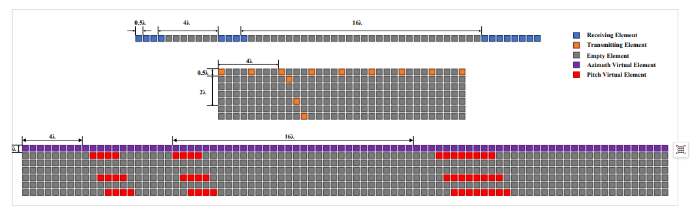
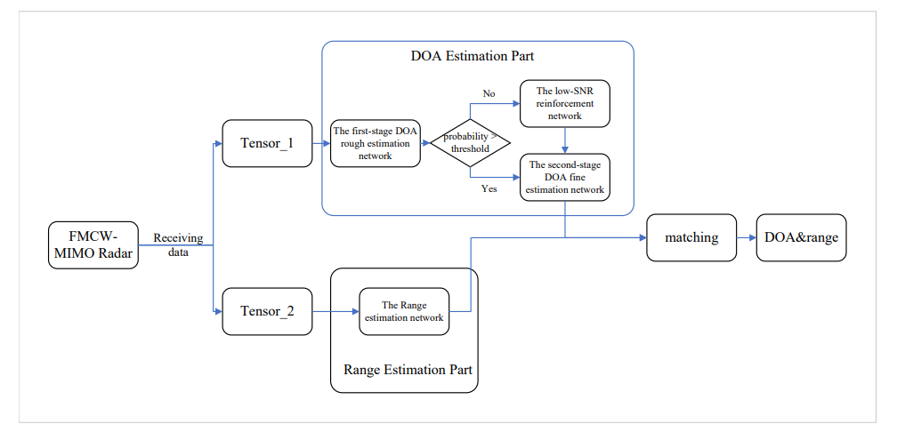
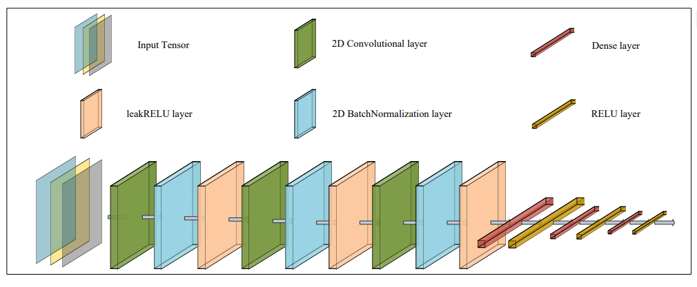
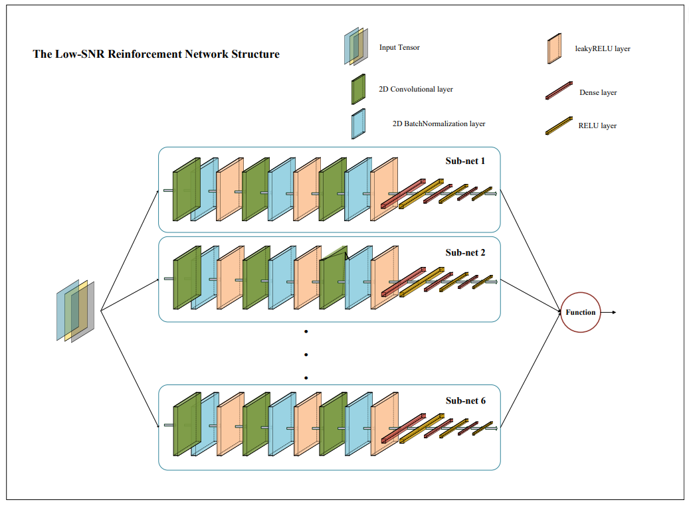
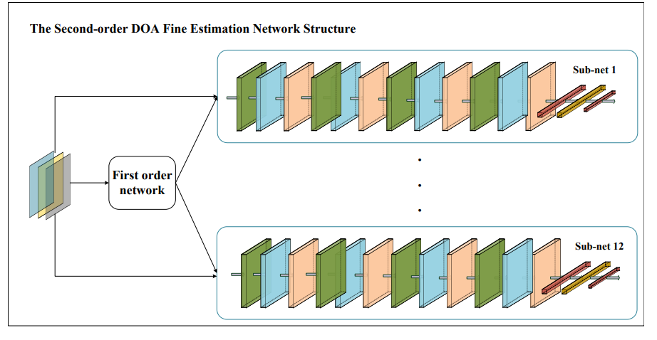
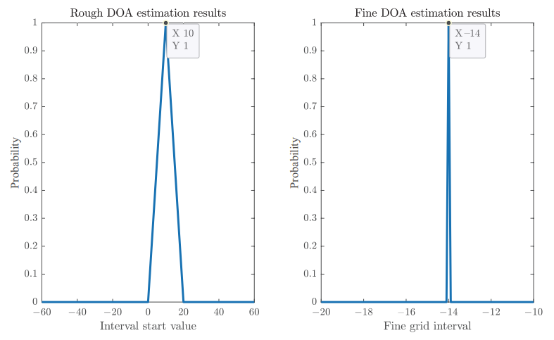
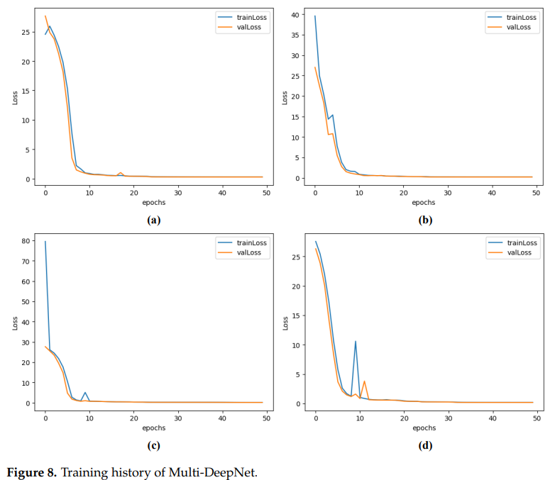
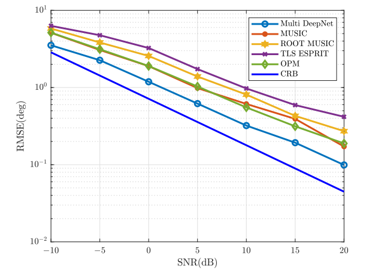
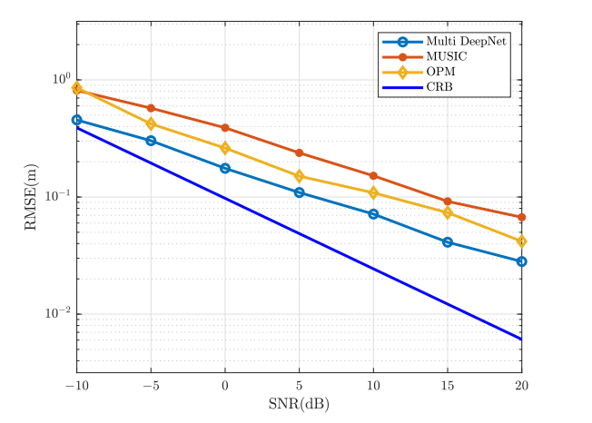

# DOA Estimation Based on Multi-DeepNet for Low Signal-to-Noise Ratio Fast-Shot FMCW-MIMO Radar Target Localization

Abstract: Frequency Modulated Continuous Wave (FMCW) Multi-Input Multi-Output (MIMO) Radar is widely used in the field of target positioning, but its positioning estimation accuracy will sharply decrease when the Signal-to-Noise Ratio (SNR) is insufficient and the number of snapshots is limited. Therefore, it is urgent to develop an effective estimation scheme suitable for low SNR and few snapshot scenarios. This paper proposes a Fast Target Localization Framework based on Multi-DeepNet, which achieves precise target localization in harsh environments through multiple collaborative deep networks. The framework first uses deep learning for coarse estimation to determine the angle range; then, multiple neural networks are designed to achieve precise angle estimation; followed by distance estimation; finally, the matching between angle and distance is completed by comparing the Frobiniuus norm. Simulation experiments and real data have verified the efficiency and accuracy of the proposed framework.
Introduction: Frequency Modulated Continuous Wave (FMCW) radar has been widely applied in civilian fields such as road vehicle monitoring and recording systems, car collision avoidance radar, traffic flow detectors, and autonomous driving systems due to its ease of implementation, simple structure, small size, light weight, and low cost. Additionally, with its excellent characteristics, researchers have also applied it to micromotion scenarios such as heartbeat detection and posture detection.
In recent years, FMCW-MIMO radar, which combines multi-input multi-output (MIMO) technology with FMCW radar, has become a research hotspot. This radar pairs the transmitter and receiver independently to form virtual elements, increasing both the array aperture and the data volume. The received signal of FMCW-MIMO radar contains DoA, velocity, and distance information, which can be used for target positioning, but it needs to solve the joint estimation problem of angle and distance.
Traditional algorithms such as 2D-FFT are limited by the Rayleigh criterion and radar bandwidth, making their performance inadequate for certain requirements. Consequently, the 2D-MUSIC algorithm has naturally been applied to joint estimation. Subsequent research has introduced various improved algorithms, including methods that combine 2D-MUSIC with matched filtering, unstructured grid algorithms, sparse spectral fitting (SpSF) algorithms, and the linear prediction-orthogonal propagation operator method based on forward and backward spatial smoothing (SS-LP-OPM). However, these algorithms either have high computational costs that do not meet real-time requirements or exhibit significant errors and average performance under low signal-to-noise ratio and few quick shots.
The advent of deep learning (DL) and machine learning (ML) has provided new ideas for areas such as direction of arrival (DOA) estimation. Algorithms based on deep learning demonstrate advantages in estimation performance, adaptability, and speed of execution. In 2021, Cong et al. proposed the use of a super-deep super-resolution (VDSR) neural network for fast joint estimation in FMCW-MIMO radars. However, this algorithm performed poorly under low signal-to-noise ratio and few quick shots, with accuracy inferior to that of the MUSIC algorithm with an accuracy of less than 0.1 degrees grid.
To address the shortcomings of existing algorithms, this paper proposes a framework for rapid target positioning based on multiple deep neural networks. By working together in parallel, multiple neural networks achieve rapid joint estimation of angle and distance in scenarios with low signal-to-noise ratio and few quick shots, balancing estimation accuracy with computational efficiency. The framework's performance is validated through simulations and experiments.
The overall framework of the Multi-DeepNet consists of two core modules: DOA estimation and distance estimation. These modules ultimately complete the joint estimation of angle and distance through matching algorithms, with the entire process including five key steps: data preprocessing, coarse estimation, fine estimation, distance estimation, and parameter matching.
The data model is based on Texas Instruments' cascading FMCW-MIMO radar system, with 10 uniform linear array elements selected from the virtual array for research. The radar transmits signals that are reflected by targets and then received, with the received signals containing information about the target's angle and distance as well as additive Gaussian white noise. By mixing, low-pass filtering, and sampling the received signals, a signal model matrix (where the steering matrix is the directional matrix, the target signal matrix is the target signal matrix, and the noise matrix is the noise matrix) is constructed to prepare for subsequent neural network input.
Neural network structure design: Data preprocessing includes calculating the sample covariance matrix and its transpose, extracting the real part, imaginary part, and phase respectively, and constructing three-dimensional tensors (for DOA estimation) and (for distance estimation).
First stage DOA rough estimation network: An input tensor is processed through three two-dimensional convolution layers, batch normalization layers, and LeakyReLU activation functions to extract features. Then, four fully connected layers output an angle probability distribution within -60°~60° range within 12 10° intervals, determining the approximate range of angles.
Low SNR enhancement network (LSR-net): It is activated when the maximum probability of the rough estimation result falls below a threshold. It consists of six sub-networks with the same structure as the rough estimation network, optimizing the interval estimation results under low SNR by averaging the output probability distribution.
Second stage DOA fine estimation network: For each of the 12 angle intervals, twelve structurally identical sub-networks are designed, with an input tensor processed through four two-dimensional convolution layers and two fully connected layers, outputting a probability distribution within 0.1° grid within the corresponding interval, achieving precise angle estimation (accuracy 0.1°).
Distance estimation network: An input tensor is processed through three two-dimensional convolution layers and one fully connected layer, outputting a probability distribution within 0.1m grid within 1m~10m range, using the position corresponding to the spectral peak as the distance estimation value (accuracy 0.1m).
The matching method is designed for multi-target scenarios, utilizing the coupling characteristics of angles and distances in the received signals to transform the matching problem into an optimization problem seeking the minimum error. It iterates through all combinations of angle-distance pairs, calculates the Frobiniu's norm of the reconstructed signal relative to the actual received signal for each combination, and selects the combination with the smallest norm as the final joint estimation result, achieving accurate matching between angles and distances.
Conclusion: This paper proposes a framework for rapid joint angle-distance estimation based on deep learning (Multi-DeepNet) for FMCW-MIMO radar. Through the collaborative work of multiple neural networks, this framework achieves rapid and precise target positioning under low SNR and few quick shots scenarios, while significantly reducing computational time.
Simulation results show that compared to traditional algorithms such as 2D-MUSIC, OPM, TLS-ESPRIT, etc., the proposed algorithm has better estimation accuracy within the -20dB~20dB SNR range (angle accuracy 0.1°, distance accuracy 0.1m), and significantly shortens the running time, maintaining a high level of positioning success even at low SNR. The real-time experiment in a microwave darkroom further validates the practicality and feasibility of this framework in both single-target and multi-target scenarios.
Although the algorithm has achieved good results, there are still some shortcomings: its advantages are not obvious in high SNR scenarios, and the overall framework structure is relatively complex. Future research will focus on simplifying the framework and network structure while enhancing the performance of the algorithm in high SNR scenarios.
End

## Images

<!-- PAYMENT_BLOCK -->

## Get this dataset

- Payment link (Stripe): [Buy now](https://buy.stripe.com/3cs8yP7sY87d0vu9AB)
- Payment QR code: 

<!-- /PAYMENT_BLOCK -->
